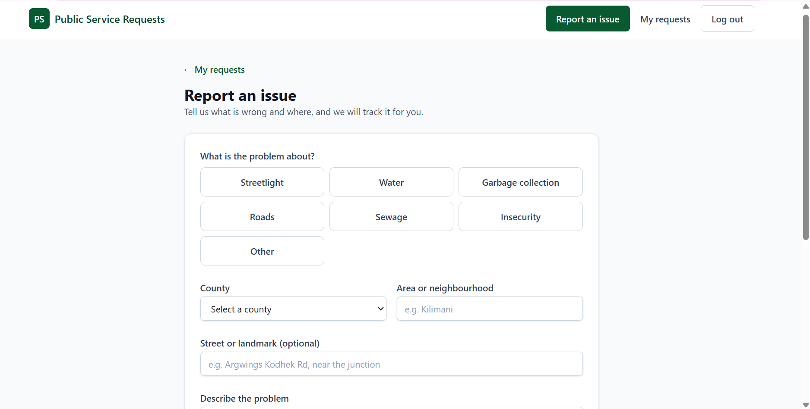
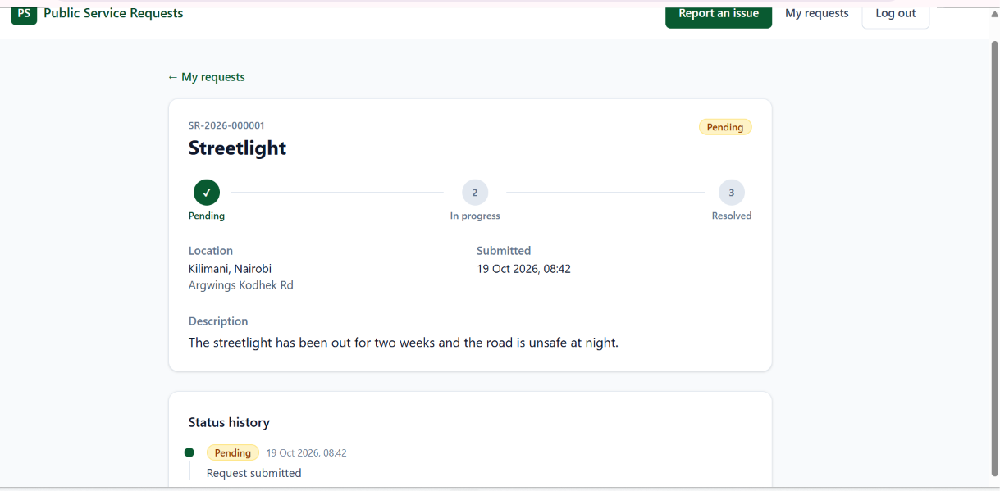
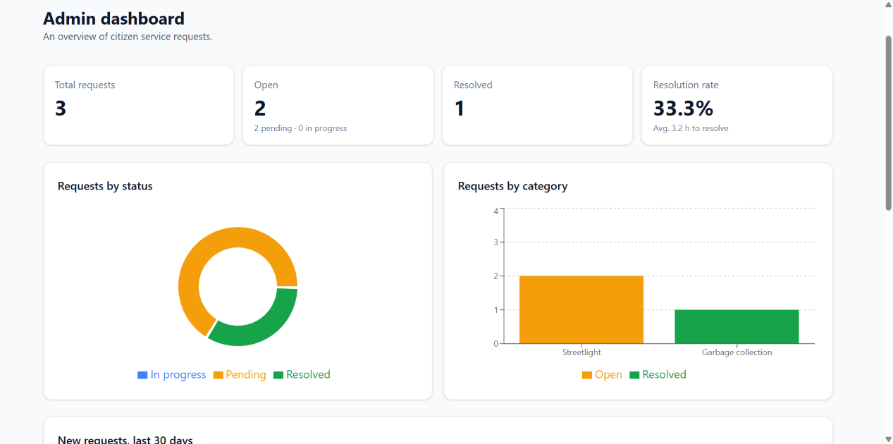
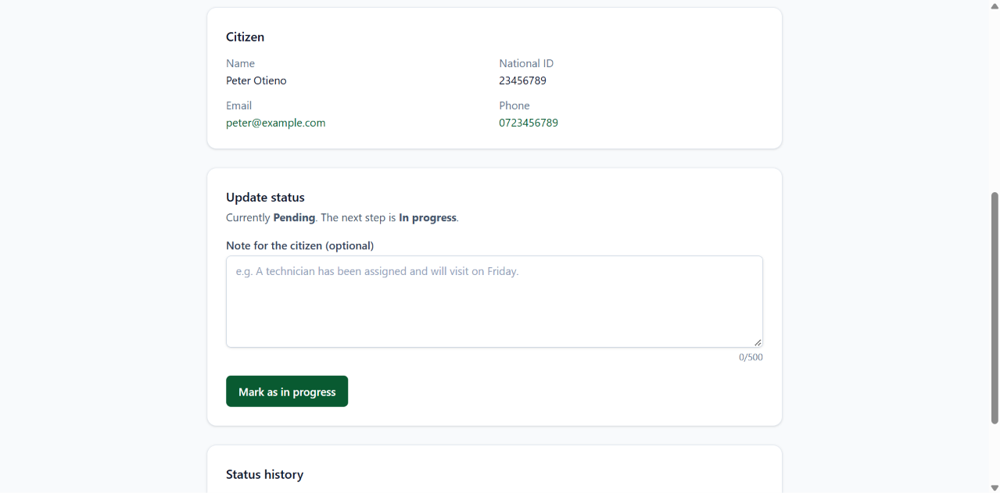

# Public Service Request System

A mini eCitizen-style web app where citizens report public service issues (broken streetlights, water problems, uncollected garbage) and track them until they are resolved. Administrators manage the queue, update statuses, and see analytics on open versus resolved cases.

- **Live app:** https://public-service-system-sigma.vercel.app
- **API:** https://public-service-system.onrender.com (health check: `/api/health`)

> **Note on the live demo:** the API runs on a free hosting plan that sleeps when idle, so the first request after a quiet period can take up to a minute. Open the health check URL once to wake it up.

## Screenshots

| Citizen: report an issue | Citizen: request tracking |
|---|---|
|  |  |

| Admin: dashboard | Admin: manage a request |
|---|---|
|  |  |

## Features

**Citizens**
- Register and log in with an email address or national ID number
- Submit a request with a category, location (county, area, optional landmark), description, and an optional photo
- Receive a unique reference number for every request (for example `SR-2026-000001`)
- Track each request through **Pending → In progress → Resolved**, with a progress indicator and a full status history that includes admin notes
- See an overview of their own requests (total, open, resolved)

**Administrators**
- Dashboard with totals, resolution rate, and average resolution time
- Charts: requests by status, requests by category (open versus resolved), and new requests over the last 30 days
- Request queue with search (reference, area, county), status and category filters, and pagination
- Request page showing the citizen's contact details, where the admin moves the request to its next status and adds a note the citizen can read

**Security and quality**
- Passwords hashed with bcrypt; sessions use signed JWTs
- Role-based access control (`citizen`, `admin`) enforced on the server
- Input validation on every endpoint with Zod, and matching client-side validation
- Rate limiting, Helmet security headers, and a CORS allow-list
- Environment variables validated at startup so misconfiguration fails fast

## Tech stack

| Layer | Technology |
|---|---|
| Frontend | React, TypeScript, Vite, React Router, Tailwind CSS, Recharts |
| Backend | Node.js, Express, TypeScript, Mongoose, Zod, JSON Web Tokens, bcryptjs, Multer |
| Database | MongoDB (Atlas) |
| Image storage | Cloudinary |
| Hosting | Vercel (frontend), Render (API) |

## Project structure

```
public-service-request-system/
├── client/                     # React + Vite frontend
│   └── src/
│       ├── components/         # Reusable UI (forms, badges, charts, tables, route guards)
│       ├── context/            # Auth context and provider
│       ├── hooks/              # useAuth, useDebouncedValue
│       ├── lib/                # API client, constants, validators, formatters
│       ├── pages/              # Route-level pages
│       └── types/              # Shared TypeScript types
└── server/                     # Express + TypeScript API
    └── src/
        ├── config/             # Environment validation, database, Cloudinary
        ├── controllers/        # Request handlers
        ├── middleware/         # Auth, uploads, rate limiting, error handling
        ├── models/             # Mongoose models
        ├── routes/             # Route definitions
        ├── scripts/            # Admin seed script
        ├── services/           # Business logic (stats aggregation, image upload)
        ├── utils/              # Helpers (JWT, reference numbers, status flow)
        └── validators/         # Zod schemas
```

## Getting started

### Prerequisites

- Node.js 20 or newer
- A MongoDB database (a free [MongoDB Atlas](https://www.mongodb.com/atlas) cluster works well)
- A free [Cloudinary](https://cloudinary.com) account (only needed for photo uploads; the rest of the app works without it)

### 1. Clone the repository

```bash
git clone https://github.com/ginakena/public-service-request-system.git
cd public-service-request-system
```

### 2. Set up the API

```bash
cd server
npm install
cp .env.example .env
```

Edit `server/.env` (see [Environment variables](#environment-variables)), then start the API:

```bash
npm run dev
```

The API runs at `http://localhost:5000`. Confirm it works by opening `http://localhost:5000/api/health`; the response should show `"db": "connected"`.

### 3. Create an admin account

Public registration only ever creates citizen accounts. To create an admin, set `ADMIN_EMAIL` and `ADMIN_PASSWORD` in `server/.env` and run:

```bash
npm run seed:admin
```

The script is safe to run more than once; it does nothing if the admin already exists.

### 4. Set up the client

In a second terminal:

```bash
cd client
npm install
cp .env.example .env.local
npm run dev
```

The app runs at `http://localhost:5173`.

## Accessing the admin dashboard

There is intentionally no "register as admin" option, so nobody can grant themselves elevated access. Admin accounts are created by the seed script described above.

To open the admin dashboard:

1. Create the admin with `npm run seed:admin` (step 3 above).
2. Go to `/login` and sign in with that email and password.
3. Admins are redirected to `/admin`, where the statistics, request queue, and status controls are.

To open a request, click its reference number (or **Manage**) in the table. The **Update status** card is on that page.

## Environment variables

### Server (`server/.env`)

| Variable | Required | Description |
|---|---|---|
| `NODE_ENV` | No | `development` (default) or `production` |
| `PORT` | No | Port to listen on (default `5000`) |
| `MONGO_URI` | Yes | MongoDB connection string. Include a database name, e.g. `.../service_requests?retryWrites=true&w=majority` |
| `JWT_SECRET` | Yes | Secret used to sign tokens (at least 8 characters; use a long random value in production) |
| `JWT_EXPIRES_IN` | No | Token lifetime (default `7d`) |
| `CLIENT_URL` | No | Allowed frontend origin(s) for CORS. Comma-separated for several, e.g. `http://localhost:5173,https://your-app.vercel.app` |
| `ADMIN_EMAIL` | For seeding | Email for the seeded admin account |
| `ADMIN_PASSWORD` | For seeding | Password for the seeded admin account (at least 8 characters) |
| `CLOUDINARY_CLOUD_NAME` | For photos | Cloudinary cloud name |
| `CLOUDINARY_API_KEY` | For photos | Cloudinary API key |
| `CLOUDINARY_API_SECRET` | For photos | Cloudinary API secret |

If the Cloudinary variables are missing, photo uploads return a clear `503` and everything else keeps working.

### Client (`client/.env.local`)

| Variable | Description |
|---|---|
| `VITE_API_URL` | Base URL of the API, e.g. `http://localhost:5000/api`. Read at build time, so redeploy after changing it |

## Available scripts

**Server** (`server/`)

| Script | Description |
|---|---|
| `npm run dev` | Start the API with auto-reload |
| `npm run build` | Compile TypeScript to `dist/` |
| `npm start` | Run the compiled build |
| `npm run seed:admin` | Create the admin account from `ADMIN_EMAIL` and `ADMIN_PASSWORD` |

**Client** (`client/`)

| Script | Description |
|---|---|
| `npm run dev` | Start the Vite dev server |
| `npm run build` | Type-check and create a production build |
| `npm run preview` | Preview the production build locally |
| `npm run lint` | Run ESLint |

## API reference

All endpoints are prefixed with `/api`. Authenticated endpoints expect an `Authorization: Bearer <token>` header. Request and response bodies are JSON, except image uploads.

| Method | Endpoint | Access | Description |
|---|---|---|---|
| GET | `/health` | Public | Service and database status |
| POST | `/auth/register` | Public | Create a citizen account; returns the user and a token |
| POST | `/auth/login` | Public | Log in with `identifier` (email or national ID) and `password` |
| GET | `/auth/me` | Authenticated | The current user |
| POST | `/uploads/image` | Citizen | Upload a photo (multipart, field name `image`); returns `imageUrl` |
| POST | `/requests` | Citizen | Submit a request |
| GET | `/requests/mine` | Citizen | The current citizen's requests, newest first |
| GET | `/requests/:id` | Owner or admin | A single request with its status history |
| GET | `/requests` | Admin | All requests. Query: `status`, `category`, `q`, `page`, `limit` (max 50) |
| PATCH | `/requests/:id/status` | Admin | Move a request to its next status, with an optional `note` |
| GET | `/admin/stats` | Admin | Totals, per-category counts, 30-day trend, average resolution time |

### Example: submit a request

`POST /api/requests`

```json
{
  "category": "streetlight",
  "location": { "county": "Nairobi", "area": "Kilimani", "address": "Argwings Kodhek Rd" },
  "description": "The streetlight has been out for two weeks and the road is unsafe at night.",
  "imageUrl": "https://res.cloudinary.com/<cloud>/image/upload/.../photo.jpg"
}
```

`imageUrl` is optional and must come from the upload endpoint. A successful response is `201` with the created request, including `refNo`, `status: "pending"`, and the first `history` entry.

### Example: update a status

`PATCH /api/requests/:id/status`

```json
{ "status": "in_progress", "note": "A technician has been assigned." }
```

### Errors

Errors return a JSON body with a `message`. Validation errors also list the failing fields:

```json
{
  "message": "Validation failed",
  "errors": [{ "field": "phone", "message": "Use a valid Kenyan number, e.g. 0712345678" }]
}
```

| Status | Meaning |
|---|---|
| 400 | Validation failed |
| 401 | Missing, invalid, or expired token; or wrong login credentials |
| 403 | Authenticated, but the role is not allowed |
| 404 | Not found (also returned for requests that belong to someone else) |
| 409 | Conflict: duplicate account, or an invalid status change |
| 429 | Too many requests (rate limited) |

## Data model

- **User**: name, email, national ID, phone, hashed password, role (`citizen` or `admin`)
- **ServiceRequest**: reference number, citizen, category, location (county, area, address, optional coordinates), description, optional image URL, status, and a `history` array of `{ status, by, note, at }`
- **Counter**: one document per year, used to generate sequential reference numbers atomically

**Categories:** streetlight, water, garbage, roads, sewage, other
**Statuses:** `pending` → `in_progress` → `resolved`

## Design decisions

- **Forward-only status flow.** A request can only move to the next status, never skip or go back, and a resolved request is final. The rule lives in one small map on the server, and invalid changes return `409`.
- **Atomic reference numbers.** A counter document incremented with `$inc` guarantees unique, sequential references even when requests arrive at the same time.
- **Ownership checks that don't leak.** Asking for someone else's request returns the same `404` as a request that doesn't exist, so ids can't be probed.
- **Admins can't be self-registered.** Registration ignores any role in the request body and always creates a citizen.
- **Generic login errors.** A wrong email and a wrong password produce the same message, so the endpoint doesn't reveal which accounts exist.
- **Two-step image upload.** The client uploads the photo first and then submits the request with the returned URL. Images go to Cloudinary because free hosts discard files written to disk on redeploy. The API only accepts image URLs from its own Cloudinary account.
- **Analytics in the database.** The dashboard numbers come from a single MongoDB aggregation (`$facet`), not from loading every request into the server.
- **Layered code.** Routes → controllers → services/utilities on the server; pages → components → API client on the frontend. Auth state lives in one context, and route guards handle login and role checks.

## Known limitations and future improvements

- No automated test suite yet; the API was tested manually with Thunder Client and the UI by hand
- The session token is stored in `localStorage`; httpOnly cookies would be safer against XSS in a production system
- No password reset or email verification
- No email or SMS notifications when a status changes
- Photos uploaded but never attached to a submitted request are not cleaned up
- The rate limiter keeps its counts in memory, so it resets on restart and isn't shared across multiple instances
- A map pin or "use my location" option for requests (the data model already supports coordinates)

## Author

Built by [@ginakena](https://github.com/ginakena).
